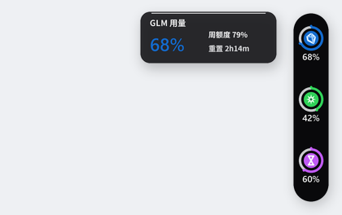
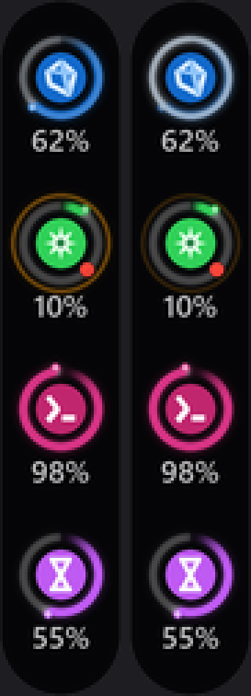

# GLM Plan Dashboard v1.40

GLM + Kimi + Codex + MiMo 四源用量悬浮小组件 + 番茄工作闹钟，深色状态轨贴靠屏幕左/右缘：44px 宽的完整胶囊中，Kimi 绿色星芒、Codex 洋红终端符、MiMo 橙色气泡火花、番茄沙漏四个图标圆环分别显示短期/套餐额度、Codex 周预算和当前番茄阶段剩余，图标下方显示百分比（**GLM 源 v1.40 起暂时停用**，见 `DISABLED_SOURCES`，删掉那个元组里的 `"glm"` 即可恢复）。拖到任意屏松手就近贴边（左/右缘皆可）；v1.31 起借鉴 Codenotch 加入**会话闲忙可视化**（忙=整环白色呼吸灯、等你输入=琥珀柔光脉冲环）、**额度阈值告警**与**点击槽位刷新对应源**；v1.32 将详情卡与右键菜单全面升级为自绘 macOS 风（popover 弹出、圆角投影菜单）。空闲时自动缩成停靠侧 6px 进度细边，鼠标触及滑出，悬停单个图标展开其局部详情卡片。

## 预览




*v1.33：busy=整环白色呼吸灯（左峰值/右谷值）· 琥珀柔光=等你输入 · 彗星渐隐额度环无端点*

## 功能

**外观与交互（v1.27）**
- **深色胶囊 + Acrylic 详情卡片**：主轨使用近黑色自绘底与等宽端帽裁切，保证任何壁纸上都有稳定的半圆外形；局部详情卡片继续使用 Acrylic 暗色材质
- **平滑边缘**：主轨以 4 倍超采样绘制后缩小，完整展开态由逐像素 alpha 形成圆弧，避免 Win32 硬区域裁切造成的锯齿；6px 收边态仍保留独立命中区域
- **数值缓动动效**：刷新后百分比数字与进度条 30fps 指数趋近新值（ease-out 观感），收敛即停，平时零开销
- **正弦调光闪烁**：阶段切换提示由开关式闪烁改为 6 秒 3 次正弦淡入淡出
- **左右贴边自动隐藏**：卡片左/右缘进入所在屏对应竖边 24px 内（两边都够到取更近者）松手，空闲 1.2 秒滑入该侧屏缘，露出 6px **竖向番茄进度条**（水位式：满格齐顶、随剩余时间自上而下回落，落空即到点；剩余 >50% 绿 / 20–50% 黄 / <20% 红）；鼠标触及该侧屏缘即滑出（启动后 5 秒宽限期不隐藏；拖离屏缘后不启用）。左/右停靠全对称：细边热区、region 裁剪、所在屏判定锚点、hover 面板展开方向（左停靠向右展开）随停靠侧镜像，跨屏拖动到哪块屏就贴哪块屏，停靠侧与位置记忆在 `ui_state.json`（旧文件无 `side` 字段按右停靠兼容）
- **hover 详情面板**：悬停单个图标 0.3 秒，在其靠屏内一侧展开 168×64 的局部详情卡片；切换图标只更新对应项，离开轨道和卡片 0.3 秒后收起

**状态轨（v1.28 · v1.35 扩至五槽 · v1.40 GLM 暂停用 → 四槽）**
- 44px 宽的完整胶囊内固定圆环：Kimi 5h 短期额度（绿色星芒）、Codex 周预算（洋红终端符）、MiMo 套餐剩余（橙色气泡火花）、当前番茄阶段剩余（工作紫 / 休息 teal / 非工作灰）。每枚图标下方显示对应剩余百分比，图标和位置保持固定，便于形成空间记忆。**GLM 深蓝晶体槽当前停用**：`main.py` 的 `DISABLED_SOURCES = ("glm",)` 一并关掉槽位、周期刷新与闲忙通知（与「故障摘牌」不同——摘牌仍会周期探测并可能复活刷日志，停用是彻底不碰），fetch / 图标 / 详情卡 / 告警代码全部保留，删掉元组里的 `"glm"` 即恢复
- 平台主色不随额度变化，低于 40% 时用橙色小点提示，低于 15% 时用红色小点提示；精确百分比、重置时间、Kimi 月额度、Codex 周绝对值（$已用/$上限）与今日消耗、MiMo 套餐已用 token 数与预算全部保留在 hover 详情中（GLM 周额度在启用时一并显示）
- Kimi 本地 daemon、Codex 中转、MiMo 端点不可用时显示灰色虚线占位环，真实额度耗尽仍是红色警示点；番茄非工作时段使用灰色沙漏环，不把它误报为额度耗尽。
- 主轨只在状态变化时重绘：番茄钟每秒一帧、额度刷新后的缓动才 30fps，保留原有离屏 Pillow + Win32 分层窗口路径，无额外运行时依赖。
- 每 5 分钟自动刷新数据，各源（Kimi 走本地 daemon、Codex 走中转站 `/v1/usage`、MiMo 走本机账本）各自独立线程拉取与落地，任一源超时不拖慢其余源的 UI 更新

**Codex 用量源（v1.28）**
- 数据来自 Codex CLI 所配中转站（`~/.codex/config.toml` 顶层 `model_provider` 指向供应商的 `base_url`，白名单 `uapi.ccwu.cc`；key 为 `~/.codex/auth.json` 的 `OPENAI_API_KEY`，Bearer 鉴权），请求 `GET {base}/v1/usage`
- 额度为 USD 计价订阅，无 5h 窗口：环语义取**周预算剩余比例**（如 (300-17.4)/300），hover 详情给「周 $17.4/$300 · 6天9h 后预计重置 · 今日 $17.4」；`daily_limit_usd=0` 且 `mode=unrestricted` 表示无日限额，今日已用只以文字呈现、绝不折算成比例
- 周重置时刻由 `weekly_window_start + 7 天` 推算（服务端无显式 reset 字段），窗口起点在未来或已越过推算点时显示「等待窗口」而非编造倒计时；安全策略沿用 GLM 源（https + 域名白名单 + DNS 后私网阻断 + 禁重定向 + 响应体 64KB 上限）

**MiMo 用量源（v1.35 槽位 · v1.36 空态语义 · v1.37 本机账本 · v1.39 官方基线）**
- MiMo 是 **token 套餐计量**，不是 GLM / Kimi 那种 5h 窗口百分比，而且**没有开箱即读的官方额度接口**（实测）：Token Plan 网关 `token-plan-cn.xiaomimimo.com/v1`（`tp-` key）只有 `/v1/models` 通，`/usage` `/quota` `/subscription` `/dashboard/billing` 等 130+ 候选路径全 404，对话响应头也不带限流头；账号级官方接口 `mimo-server-cn.xiaomimimo.com/api/user/usage` 与 `/api/user/xiaomi/subscription/self` 存在（返回 `{code:0,data:{percent,resetDate}}`），但只认小米账号会话 cookie——那份库在 MiMo Desktop 运行期间被独占锁死，Chrome 里也没有 xiaomimimo 的 cookie；`platform.xiaomimimo.com/api/v1/*` 是网关统一 401（连 `/api/v1/zzzz` 都 401），枚举不出真路径
- 因此走**本机账本 + 官方基线**：账本是 `~/.local/share/mimocode/mimocode.db`（路径遵循 `MIMOCODE_HOME` / `XDG_DATA_HOME`），只读打开（`mode=ro&immutable=1`）统计 assistant 消息的消耗。**口径 = `input + output + reasoning + cache.read + cache.write`（含缓存读，即引擎的 `total`）**——对过账：官网显示 664,754,691 已用时，本机同口径约 109.5M，而扣掉 `cache.read` 的旧口径只有 4.2M，量纲差 150 倍，缓存读必须算进来。provider 只取 MiMo 自家（`mimo-desktop` 走桌面代理、`xiaomi*` 走 Token Plan / 计费网关），别的供应商不算进来
- **官方基线**（v1.39）：官方已用量只在账号侧，查不到就由使用者从官网「套餐使用情况」抄一次：

  ```json
  "mimo": {
    "budget": 11000000000,
    "baseline_used": 664754691,
    "baseline_local": 109543046,
    "baseline_at": 1791861505,
    "url": "https://…/usage",
    "token": "…",
    "auth": "bearer",
    "header": "Authorization"
  }
  ```

  **最终已用 = `baseline_used` + (本机装机以来 − `baseline_local`)**——起点是官网真值、增量是本机真值，每个数都有出处。`baseline_local` / `baseline_at` 是抄数那一刻本机账本的值与时刻（自动记录，手工改基线时一起填）。配了基线就改用「装机以来全部本机消耗」而非自然月窗口：官网套餐是「11-12 到期」那种 13 号对 12 号的滚动周期，按自然月切会让基线在月初失效
- **已知边界**：基线之后**别的设备**（网页 / 手机 / 其他电脑）的消耗记不进来，环会偏乐观；官网数字更新（续费、换套餐、跨周期）时把新数字告诉我重设基线即可。没配 `budget` 就保持虚线空环，但 hover 与 tooltip 仍如实显示已用量——宁可不画比例，也不拿猜的分母算百分比
- `url` 是**可选**的远端端点，配了就优先于本机账本；`auth` 三选一：`bearer`（默认，`Authorization: Bearer <token>`）/ `header`（`header` 指定的头放原文，如 `X-Api-Key`）/ `cookie`（原文整段作为 `Cookie` 头）。远端响应按字段名做 ≤4 层浅查找：`remaining*` 当剩余、`percent` / `usedRatio` / `used*` 当已用（`100 − 已用`），数值 ≤1 按比例 ×100、>1 按百分数，字符串 `"41%"` 也能吃；重置点取 `reset*` / `nextResetTime` / `expire*`，兼容 epoch 秒、毫秒与 ISO-8601
- 远端安全策略沿用 GLM / Codex 源：仅 https、DNS 解析后逐 IP 阻断私网/环回/链路本地/保留/组播地址、禁重定向（`_OPENER`）、响应体 64KB 上限、10s 超时、429 指数退避；因端点由使用者配置，不做硬编码域名白名单（白名单会让改配置立即失效）
- **两种来源都拿不到数**才返回 None（虚线空环 + `--`）。**没配远端端点**时槽位一直挂着（图标常在）；**配了远端端点却拉不到**才计入无响应，连续 3 轮后整个槽位自动摘牌、配通一次即挂回

**番茄工作闹钟（下段）**
- 锚定作息表：工作日 9:00–11:30、13:30–18:00 两个时段内连续跑「45 分钟工作 ↔ 15 分钟休息」；时段尾自然截断（上午 11:00–11:30、下午 17:30–18:00 为 30 分钟收尾工作段，倒计时递减到 0 正好落在午休/下班边界）
- 节假日 / 调休自适应：chinese-calendar 判定中国法定节假日与周末补班，调休补班的周末照常计时，假期显示「假日」不计时；库缺失或数据超范围时退回「周一~周五」近似
- 状态由墙钟每秒推导（非累计计时）：任意时刻启动即对位、睡眠/挂起后自动恢复、阶段边界不随运行时长漂移
- 时段外显示「待机 / 午休 / 下班 / 假日」+ 下次开工时刻；阶段切换、上/下午开工、午休、下班均弹 Windows 通知并闪烁提示
- 阶段圆点（工作=专注紫 / 休息=teal / 非工作=灰）+ 粗体阶段词（思源黑体）+ 等宽倒计时（冒号每秒呼吸）+ 5px 胶囊进度条（按标准 45/15 分钟归一，与倒计时严格同比例递减，归零即切阶段）

**通用**
- 右键菜单：立即刷新 / 保持展开 / 重置时间显示时刻 / 开机自启 / 退出
- 单击槽位：只刷新对应源；点击展开的详情卡：钉住 / 解除
- 可拖拽移动位置（拽着隐藏态细边拖动，松手处就地恢复整卡；松手时就近更新停靠侧）
- 圆角半透明悬浮窗口
- 支持开机自启动（登录后启动）

## 实施方案

- **语言**: Python 3
- **GUI**: tkinter（无边框置顶窗口 + Win32 分层窗口实现逐像素透明）
- **图像**: Pillow（PIL）绘制电池图标与番茄图标，支持圆角和抗锯齿
- **番茄钟**: `root.after` 每秒驱动倒计时状态机
- **通知**: winotify（WinRT toast）+ 注册表注册应用 AUMID，显示番茄图标与应用名
- **API**: 优先实时读取 ZCode 配置（`~/.zcode/cli/config.json` 当前供应商 + `~/.zcode/v2/config.json` 的 apiKey/baseURL），调用 GLM 配额接口获取用量；详见下方「API 配置来源」
- **刷新**: 后台线程请求 API，主线程更新 UI，5 分钟轮询

## 安装与运行

```bash
pip install -r requirements.txt
python main.py             # 或双击 start.bat（pythonw 无窗口启动）
```

**API 配置来源（优先级从高到低）**：

> **GLM 源当前停用（v1.40）**：`main.py` 的 `DISABLED_SOURCES = ("glm",)` 会一并跳过状态轨槽位、周期刷新与闲忙通知，所以下面这套 GLM 配置优先级暂时用不上（也就不必再为它修 key）。要恢复：删掉该元组里的 `"glm"`；若 key 已失效，先按下方「刷新兜底 key」重跑 `setup_config.py`。

1. **ZCode 当前配置（默认生效，自动跟随更新）**：`~/.zcode/cli/config.json` 的 `model.providerId` 记录 ZCode 当前选中的供应商，其 `apiKey` / `baseURL` 明文存于 `~/.zcode/v2/config.json` 的 `provider[<id>].options`。仪表盘每次刷新（5 分钟）都现读这两个文件，**在 ZCode 里换 key、换供应商后无需任何手动操作**，最迟一个刷新周期自动生效。若活动供应商无可用 key（如切换到 OAuth 类套餐），自动改用配置中任一已启用且带 key 的供应商。
2. **项目 `config.json`**（已被 `.gitignore` 忽略，不会上传 key）：ZCode 不可用时的独立兜底，由 `setup_config.py` 固化。
3. **环境变量** `ANTHROPIC_BASE_URL` / `ANTHROPIC_AUTH_TOKEN`。
4. **`~/.claude/settings.json`** 的 `env` 字段（兼容 Claude Code）。

> **刷新兜底 key**：兜底 `config.json` 里的 key 过期后，重跑 `python setup_config.py` 即可——它会跳过已有 `config.json`，从 ZCode / 环境变量 / `~/.claude/settings.json` 读取最新配置写入（只覆盖 `base_url` / `token`，`mimo` 等手工段原样保留）。

> **MiMo 用量**：走本机账本 + 官方基线（`config.json` 的 `mimo.budget` / `baseline_used` / `baseline_local` / `baseline_at`，见上方「MiMo 用量源」），零配置也有「本机本月已用」。官网数字变了把新值告诉我重设基线即可；另可选 `url`/`token` 指到远端额度端点。最迟一个刷新周期生效。

**开机自启**：悬浮窗上右键 →「开机自启（点击切换）」，开启后登录 Windows 自动后台启动；对应注册表项 `HKCU\Software\Microsoft\Windows\CurrentVersion\Run` 的 `GlmDashboard`。

**从 Agent / 沙盒环境重启（重要）**：DSH 等自动化沙盒把每条命令放进带 `JOB_OBJECT_LIMIT_KILL_ON_JOB_CLOSE` 的 Windows Job Object，命令一结束整棵进程树（含 `wscript` 拉起的 pythonw）会被强制回收——表现为"启动成功、几秒后无声消失、无任何日志"。正确做法是让 explorer 代为启动，使 pythonw 挂到 explorer 进程树下、脱离沙盒 Job：

```powershell
C:\Windows\explorer.exe "E:\GIT_Space\glm-plan-dashboard\launch-dashboard.vbs"
```

在沙盒里直接 `wscript launch-dashboard.vbs`、`pythonw main.py` 或 `schtasks` 均不可行（前两者被 Job 连坐回收，后者被沙盒拦截）。进程在跑但看不到悬浮窗时，先检查它是否缩成了屏缘 6px 细条（鼠标触及该侧屏缘即滑出），位置记忆在 `ui_state.json`。

## 更新日志

### v1.40
- **GLM 源暂时停用**：key 失效后接口恒回 `Authentication Failed`，连续 3 轮就摘牌、重启又挂回来，日志被刷满，而使用者暂时不用 GLM。新增 `DISABLED_SOURCES = ("glm",)`——**一处开关同时关掉状态轨槽位、周期刷新与闲忙通知**（停用 ≠ 故障摘牌：摘牌仍会周期探测、成功一次就复活并刷日志，停用是彻底不碰）。状态轨由五槽回四槽（Kimi / Codex / MiMo / 番茄，`WIDGET_H` 312 → 252，仍由 `SLOT_LAYOUT` 单一派生）。**fetch、图标、详情卡、告警代码全部保留**，删掉元组里的 `"glm"` 即恢复；README 的「API 配置来源」加了停用说明

### v1.39
- **MiMo 改成「官方基线 + 本机增量」，环终于和官网对上**：v1.37 只用本机账本，官网显示 `664,754,691 / 11,000,000,000 已用 6.0%`（剩 94%）时环却是 100%。两处差距——① 口径少了 `cache.read`（旧口径本机 4.2M，含缓存读才 109.5M，量纲差到 150 倍）；② 本机账本只覆盖「装机之后、这台机器」，官网是整个套餐周期 + 所有设备。现改为 `已用 = 官方基线 + (本机装机以来 − 基线时刻本机值)`，`baseline_used` / `baseline_local` / `baseline_at` 由使用者从官网抄一次写进 `config.json`，起点与增量都是真值
- **口径补上缓存读**：`input+output+reasoning+cache.read+cache.write`（引擎的 `total`），与官方量纲一致；tooltip 文案按是否套了基线分别写「套餐已用（官网基线 + 本机增量）」/「本机本月已用（未套基线）」
- **配基线后改用「装机以来」而非自然月窗口**：官网套餐是「11-12 到期」这种 13 号对 12 号的滚动周期，按自然月切会让基线在月初失效、已用量凭空掉回基线
- 实测：基线 `664,754,691` 写入后环显示 **94%**，与官网「已使用 6.0%」一致（已验真）

### v1.38
- **token 缩写补 B 档**：`_fmt_tokens` 增加十亿档（`11000000000 → 11.0B`）——Token Plan 的月预算是十亿级，只有 M 档会显示成「预算 11000.0M」，详情卡右列 ~74px 根本放不下
- **写清本机账本的覆盖边界**：`mimocode.db` 是 MiMo Desktop 安装当天才建的，安装前、以及别的设备上的消耗记不进来——「已用」是下界、剩余是上界，总额度大时环会长期贴 100%，要看的是 hover 里的已用绝对值（功能小节已补这条说明）
- 本机账本 + `mimo.budget` 组合现已实测跑通：`已用 3.5M / 预算 11.0B → 环 100%`，读数落盘 `ui_state.json` 的 `readings.mimo`

### v1.37
- **MiMo 改读本机账本（默认零配置）**：官方额度接口走不通——Token Plan 网关 50 多个候选路径全 404，账号级 `/api/user/usage` 只认小米账号会话 cookie（MiMo Desktop 运行时那份库被独占锁死）。改为只读打开 `~/.local/share/mimocode/mimocode.db`，按 assistant 消息的 `tokens.{input,output,reasoning}` 统计**本机本月已消耗**（`input+output+reasoning`，不含 `cache.read`；provider 只取 `mimo-desktop` / `xiaomi*`），hover 与详情卡如实显示「已用 2.9M」这类事实读数
- **预算可配**：`config.json` 的 `mimo.budget`（月度 token 预算）是套餐总量——唯一没有公开接口可查的数字，只有使用者知道。配了环就画 `(预算 − 已用) / 预算`，没配就保持虚线空环，**绝不拿猜的分母算百分比**；`mimo.url` 降级为可选远端端点，配了优先于本机账本
- 远端端点解析逻辑与安全策略不变（字段名浅查找兼容 `percent` / `usedRatio` / `remaining`，仅 https + 私网 IP 阻断 + 禁重定向 + 64KB 上限）

### v1.36
- **MiMo 未配置不再摘牌**：v1.35 把「`config.json` 里没有 `mimo` 段」当成抓取失败去计数，连续 3 轮后整个槽位被摘掉——刚加进去的 MiMo 图标反而永远看不见（日志里那句 `mimo 连续 3 次抓取无响应` 就是这个）。改为**未配置时保持挂载**（灰色虚线空环 + `--`，hover 详情写明原因），只有**配了端点却拉不到**才计入无响应、3 轮后摘牌；已在摘牌态的会在下一轮刷新自动挂回

### v1.35
- **新增 MiMo 第 5 槽**：番茄钟之前插入 MiMo 用量槽位，橙色圆环显示**套餐剩余比例**（剩余递减，与全卡一致），下方百分比、hover 详情（套餐名 / 月额度 + 重置倒计时）、点槽单刷、429 退避、告警带、跨启动保留读数全部对齐既有三源；槽距与总高仍由 `SLOT_LAYOUT` 单一派生（44×252 → 44×312 五槽）
- **MiMo 图标**：橙色圆盘 + 白色「对话气泡 + 四角火花」剪影——气泡尾巴刻意做宽做短，12px 下不会读成一面旗；与 GLM 晶体 / Kimi 星芒 / Codex ❯_ 同属高对比简洁剪影，火花与气泡之间留 0.3×半径缺口，缩图后仍读得出是两个元素。盘色取小米橙 `#FF6900` 并深一档压底盘，避开额度告警橙的相似度
- **用量端点可配置**：MiMo 侧没有「装好即可读」的额度接口（Token Plan 网关只有 `/v1/models`，账号级 `/user/usage` 要小米账号会话 cookie，MiMo Desktop 运行时该库被独占锁住），改由 `config.json` 的 `mimo` 段提供 url/token/auth，字段名浅查找兼容 `percent` / `usedRatio` / `remaining` 等常见写法；未配置走虚线空环，不伪造读数
- `setup_config.py` 改为只覆盖 `base_url` / `token` 两个字段，重跑不再抹掉 `config.json` 里手工加的 `mimo` 段
- 顺带补记：GLM 用量接口 HTTP 200 但业务层失败（如 key 过期）时打印 `msg` 留痕，不再只返回静默 None（此前排查时日志一片空白）

### v1.34
- **源无响应自动摘牌**：连续 `DEAD_AFTER=3` 轮抓取失败的源整体移出状态轨（窗口高度随可见槽数收缩、竖直中心保持不变），周期刷新仍照常探测，任一源恢复成功一次即自动挂回；点击槽位刷新、hover 详情、告警带对摘牌态同样生效

### v1.33
- **会话闲忙改呼吸灯**：busy 态弃用环内细弧旋转，改为整环冷白柔光以 2.4s 周期正弦呼吸（待机指示灯观感，环芯亮度与光晕强度同步起伏）；blocked 琥珀脉冲同样走柔光管线；动画帧率 200/500ms → 100/120ms 保证呼吸平滑，相位取墙钟帧率无关
- **额度环去端点（彗星画法）**：进度弧不再画前后两个圆头端点——尾部 smoothstep alpha 渐隐融入暗色轨道，头部收成一颗向白提亮的发光核心，接近满环时整圈无缝闭合成完整圆环
- **柔光质感对齐参考图**：每枚状态环改为「宽柔光 halo + 近距辉光 + 清晰环芯」三层合成（环层两级高斯模糊后垫底），任意壁纸下都有柔和发光轮廓；无数据虚线环、额度告警小点语义不变（预览见 `docs/v133-breathing-preview.png`）

### v1.32
- **详情卡弹出动画重做**：弃用从屏幕右侧滑入，改为 macOS popover 式——从被悬停槽位的圆环位置以 0.82→1.0 缩放 + 淡入直接弹出（锚定槽位中心、贴轨一侧边缘，约 110ms ease-out；与停靠侧无关，左/右停靠均自然），切换槽位同样从新槽位弹出
- **右键菜单重做为自绘 macOS 风**：弃用系统 tk.Menu，改用与详情卡同管线的 PIL + 分层窗口自绘——圆角暗色卡片 + 发丝描边 + 顶部内高光 + 高斯柔和投影，悬停项苹果蓝圆角高亮条，思源黑体；开关项文案随状态切换（保持展开⇄恢复隐藏、显示时刻⇄显示倒计时）；弹出于插件与详情卡外侧（水平错开不遮挡二者）、垂直方向夹取在屏幕可见区内；悬停/点击/Escape/焦点外点击关闭全套交互（预览见 `docs/menu-preview.png`）
- **详情卡钉住与 hover 共存修复**：v1.31 引入的钉住在启用后 hover 其他槽位不再弹出详情，现改为 hover 新槽位时钉住自动让位、详情卡切换过去，不挡正常浏览
- 修复右键菜单「一闪就关」：菜单在右键按下瞬间弹出，而点击外关闭兜底（物理按键轮询）在右键仍按住时就判定「菜单外按下」把菜单关掉——改为先检测到一次按键全松开后才武装外关判定，之后的按下才算一次新点击

### v1.31
- **会话闲忙可视化（借鉴 Codenotch）**：后台线程每 2 秒扫描本机 CLI 会话文件信号（GLM 看 `~/.claude/projects/**/*.jsonl`、Kimi 看 `~/.kimi-code/server/events/session_*.jsonl`、Codex 看各账号 `sessions/**/rollout-*.jsonl`）——90 秒内有写入为**忙**（环内白色细弧旋转），停写 15 分钟内进程仍在为**阻塞等待**（环外琥珀脉冲环），其余空闲；只读 stat 不读文件内容。忙→闲跳变时主轨临时滑出 5 秒 + 系统提示音 + toast（「会话结束 / 在等你输入」）。进程快照走 Toolhelp32 W 版 API，5 秒缓存
- **额度阈值告警**：各源主额度已用跨越 80% / 100% 时推 Windows 通知，每次跨越只提醒一次；用量明显回落（窗口滚动）后自动复位。告警带持久化在 `ui_state.json`
- **点击槽位刷新对应源**（借鉴 Codenotch 点环重拉该 provider）：按下-松开位移 <5px 判定为点击，只重拉该源并重置刷新周期；拖拽行为不变
- **详情卡钉住（Keep open）**：点击展开的详情卡钉住（右上角出现小圆点），不再随鼠标离开收起，再点解除；右键菜单新增「保持展开」开关，开启后状态轨不再自动贴边隐藏
- **重置时间双模式**：右键菜单切换倒计时（`重置 3h05m`）⇄ 时刻（`重置 14:30`，Codex 跨天为 `09-29 09:00`）
- **跨启动保留最后读数**：各源读数成功刷新即落盘 `ui_state.json`（60s 节流），启动即显示上次读数，不再有几分钟空轨道；已过期的 reset_ts 不恢复
- **Codex 多账号**：启动时发现 `~/.codex-<slug>`（带 auth.json）目录，每个账号独立槽位（默认在前、slug 按字母序、位置固定），各自独立 fetch / 告警 / 详情卡（标题 `Codex·slug`）；槽位布局由 `SLOT_LAYOUT` 单一派生，总高随槽数自适应
- **空闲降频 + 429 退避**：全部源无会话活跃时轮询 5→10 分钟，任一源 busy/blocked 即恢复 5 分钟；某源返回 429 时 60s 起步指数退避封顶 15 分钟，退避期内跳过该源
- 修复进程名匹配永远落空的问题：Toolhelp32 缺省解析到 ANSI 版 `Process32First`，宽字符字段读出乱码，显式改用 W 版

### v1.30
- **修复运行期「静默死亡」**：`after` 回调链（hover 轮询 / 番茄钟秒循环）此前在一轮中途抛异常即永久中断——hover、贴边滑出、详情面板全部失灵但拖拽仍可用，且无任何日志；现拆出单轮实现，外层 try/except 记日志 + finally 照常续跑，单轮异常不再拖死整条链
- **日志常开**：stdout/stderr 改由 `_Tee` 同时扇出到原输出与 `dashboard.log`，写入永不抛异常；此前仅在 `sys.stdout is None`（pythonw 无窗口）时接管日志，终端启动场景下管道失效后 `print` 抛 `BrokenPipeError` 还会杀死抓取线程，对应数据源（如 Kimi）永远停在初始值
- **抓取线程兜底**：`_do_refresh` 的拉取线程加异常捕获，fetch 抛错也正常走 `apply(None)` 落地流程，不再静默丢失该轮刷新

### v1.29
- **左右双缘贴边**：贴边隐藏从右缘专属扩展为左/右对称——卡片左/右缘进入所在屏对应竖边 24px 内即视为停靠（两边都够到取更近者），空闲滑入该侧；细边唤出热区、region 裁剪、所在屏判定锚点、hover 详情面板展开方向（左停靠向右展开）全部随停靠侧镜像；跨屏拖动照常生效（边沿按窗口所在屏判定）；停靠侧与位置一并记忆于 `ui_state.json`（旧文件无 `side` 字段按右停靠兼容）
- **细边进度条改水位式**：竖向番茄进度条由顶部锚定（时间越少从底部上缩）改为水位自上而下回落——满格齐顶、随剩余时间下降，落空即到点，方向与「倒计时流逝」直觉一致；口径不变（当前番茄阶段 45/15 分钟归一，非工作时段空轨道）
- 拽着隐藏态细边拖动后松手：就地恢复整卡视觉（此前 6px 细条会悬在屏中间既唤不出也不贴边）；拖拽期间不再触发滑出动画，落点统一由松手决定；松手时就近更新停靠侧

### v1.28
- **新增 Codex（中转 GPT 订阅）第 4 槽**：洋红终端符 ❯_ 图标圆环显示周预算剩余（USD 计价无 5h 窗口，环语义仍为剩余递减）；hover 详情给「周 $已用/$上限 · N天Mh 后预计重置 · 今日 $消耗」，无日限额只以文字标注不折算比例。方案经 Codex/DS/Kimi 三方圆桌评审定稿（纪要见 `docs/codex-slot-roundtable.md`）
- **布局紧凑化**：44×232 → 44×252 四槽（槽距 75→60）；槽位常量合并为单一 `SLOT_SPECS` 派生（此前加槽需同步 5 处）
- **刷新链改每源独立线程**：GLM/Kimi/Codex 各自拉取、各自 `root.after` 落地，任一源一次 10s 超时不再连带推迟其余源 UI 更新（旧实现顺序 fetch）
- **数据健壮性**：tomllib 读 config.toml（供应商名跟顶层 `model_provider` 走不写死）、auth.json key 容错（Bearer 前缀剥离）；SSRF 校验沿用 GLM 策略并加响应体 64KB 上限；周重置推算带合理性校验（窗口起点在未来/已过期均不推算）

### v1.27
- **44px 深色胶囊状态轨**：主轨收窄为上下半圆端帽的近黑色胶囊；GLM、Kimi 与番茄阶段均以「品牌色底盘 + 进度圆环 + 下方剩余百分比」呈现。
- **按项 hover 详情**：悬停图标只显示对应的 168×64 局部详情卡片，切换项目时原卡片直接更新定位，不再展开整条状态轨的汇总面板。
- **边缘质量**：完整状态改为逐像素 alpha 圆弧，并以 4 倍超采样后缩小，移除 Win32 硬区域裁切导致的端帽锯齿；绘制约 2.4ms/帧。

### v1.26
- **窄幅状态轨**：140px 横向胶囊卡改为 56px 三槽轨道；GLM 深蓝晶体、Kimi 绿色星芒和番茄沙漏外圈展示短期额度或当前阶段剩余，悬停详情继续承载精确读数与重置/周/月信息。
- **状态语义**：低额度使用橙/红警示点，不覆盖平台品牌色；Kimi 无数据、真实额度耗尽和番茄非工作状态采用不同图形，避免把空态误报为低额度。
- **渲染负载**：删除主卡内不再呈现的重置进度动画和长周期数值缓动，主轨只平滑更新两类短期额度。

### v1.25
- **上段改版为 macOS 用量监控式横向胶囊条**：弃用 v1.21 的「TOKEN 竖排 + GLM/KIMI 各三根竖条」三列布局，改为每个平台一组标题 + 三行「左标签（5h / 重置 / 周、月）+ 右数值 + 下方横向胶囊进度条」——标签与百分比在条上方、深灰轨道 + 分级色填充，贴参考图样式。卡片 140×192 → 140×232 加高容纳六行，番茄钟下段整体下移。顺带改进：周/月剩余条由恒红改为与 5h 条一致的分级色；重置行新增 `H:MM` 倒计时数字（此前竖条无数字）；删除不再使用的 `_draw_vertical_capsule` / `_draw_column_header`

### v1.24
- **修复贴边隐藏在多屏环境下的两处越界**：① 细边唤出热区右界越出屏缘 8px 落在邻屏左缘上，鼠标在邻屏左缘移动就把卡片拽出再缩回，表现为卡片在两屏间反复弹跳——热区收紧为严格在本屏内（`px < sw`，屏缘内侧 16px 仍可正常唤出）；② 隐藏态漏撤 DWM 圆角偏好，DWM 按窗口矩形（身体伸在邻屏上）描出一圈整卡轮廓线——细边模式切换时同时改 DONOTROUND，邻屏彻底干净，严格只在本屏边缘显示一条竖向番茄进度条

### v1.23
- 多屏贴边修复：所在屏按可见锚点判定 + 停靠位置记忆（`ui_state.json`）；隐藏改原地缩边（region 裁窄 + 关 Acrylic，邻屏无残影）；悬空带计入热区消除贴边弹跳；DWM 圆角偏好让毛玻璃底真正圆角

### v1.22
- **苹果风改版 · 材质**：Win11 Acrylic 真毛玻璃背景（`SetWindowCompositionAttribute` + 暗色 tint），替代 PIL 自绘卡片底；圆角改用 `SetWindowRgn` 裁剪 12px（`DWMWA_WINDOW_CORNER_PREFERENCE` 与分层窗口渲染冲突会致窗口不可见，故弃用）；发丝描边与顶部内高光保留；API 不可用的老系统自动回退 PIL 自绘卡片
- **苹果风改版 · 动效**：用量数字/进度条刷新后 30fps 指数缓动到新值（`_set_targets` / `_animate_tick`，收敛即停零开销）；番茄钟阶段切换闪烁改为 6 秒 3 次正弦调光；抓取结果改由 `_apply_usage` 在 UI 线程统一应用，顺带消除后台线程直改状态的隐患
- **苹果风改版 · 交互**：贴边自动隐藏——停靠右缘且空闲 1.2 秒滑出屏幕只留 6px 微光细边（`_create_strip_image` 竖向光条提示位置），指针触及右缘滑回，启动 5 秒宽限；hover 0.4 秒从卡片左缘滑出 Acrylic 详情面板（`create_detail_image`，精确百分比 / 重置时刻 / 番茄钟 / 上次刷新），指针离开收回；拖拽时自动收起面板且不触发隐藏
- **分层窗口渲染顺序约束**：Acrylic / SetWindowRgn 必须在首次 `UpdateLayeredWindow` 之后应用，否则渲染通道不生效、窗口整体不可见（主卡片与详情面板共用此顺序）
- 排版微调：列顶数字 11→12px；详情面板中文走中文字体（Segoe 无 CJK 字形）
- **修复番茄钟进度条与剩余时间不符**：时段尾截断段（11:00–11:30 / 17:30–18:00 的 30 分钟收尾段）进度按截断后时长归一，导致「剩 24 分钟却显示 82%」；改为始终按标准阶段时长（45/15 分钟）归一，进度条读数与倒计时严格同比例，截断段从 67% 起步
- **贴边细边升级为竖向番茄进度条**：隐藏后露出的 6px 细边显示当前阶段剩余比例——顶部锚定向下流干、到底为空，颜色按剩余比例分级（>50% 绿 / 20–50% 黄 / <20% 红），收起状态也能一眼看出还能撑多久
- **渲染性能**：`_update_layered_window` 的 premultiply 由 Python 逐字节循环改为 `ImageChops.multiply`（C 层逐像素），消除每秒重绘与 30fps 动画时的卡顿
- **中文换思源黑体**：`ZH_FONT` 首选 NotoSansSC-VF（思源黑体可变字体，wght=700；`_load_font` 新增 weight 参数支持可变字体轴），缺失时回退微软雅黑/黑体；数字保留 Segoe UI 等宽步进

### v1.21
- **上段重排为三列双平台布局**：第一列竖排「TOKEN」标识（竖发丝线分组）；第二列「GLM」三条竖向进度条（短期剩余 / 5h 重置倒计时 / 周剩余，原三条横条全部竖向化）；第三列「KIMI」三条竖向进度条（短期剩余 / 5h 重置倒计时 / 月额度剩余）。列顶各带短期剩余小数字（无数据显示「--」）。卡片 84→140px 加宽，番茄钟下段不变
- **新增 Kimi 用量源**：读 Kimi Code CLI 本地 daemon（`~/.kimi-code/server/instances/*.json` 动态端口按心跳取最新 + `server.token` 鉴权），请求 `/api/v1/oauth/usage` 解析 `limit5h` 与 `monthTotal` 的 `usedRatio/resetAt`；实测该账号无 `limit7d`（周窗口），长周期额度按月度显示。daemon 未跑时保持空轨道不伪造读数
- **修复网络读取超时未捕获**：`urlopen` 只把连接阶段超时包成 `URLError`，读响应阶段的裸 `TimeoutError` 不在捕获列表，网络抖动会让刷新线程带 traceback 崩一轮；两处 fetch 补 `OSError` 兜底
- 通用化重置倒计时逻辑（`_reset_frac` / `_reset_pulse`），GLM 与 Kimi 黄竖条共享整分心跳与满刻度校准

### v1.20
- **黄条整分心跳脉冲**：5h 满刻度摊在 56px 条宽上每分钟只收缩约 0.2px（5 分钟才挪 1 像素），窗口重置倒计时条视觉上"不走字"。新增 `_quota_pulse()`——每分钟第 0 秒达峰、6 秒内线性衰减，黄条填充色向白混合（峰值 60%）后渐回，借每秒重画帧形成整分心跳，用颜色节律代替不可见的位移。无 `nextResetTime`（空轨道）与番茄钟闪烁（dim）期间不脉冲。

### v1.19
- **短期与周额度分离**：主 `TOKEN` 数字与黄色重置条只读取 `TOKENS_LIMIT unit=3` 的 5 小时窗口；此前按 `nextResetTime` 选择时，短期窗口缺少重置时间会误选周窗口，造成主数值显示周额度剩余。短期响应不含 `nextResetTime` 时，黄色条保持空轨道而不伪造倒计时。周窗口（`unit=6`）改由右缘红色竖条展示剩余比例，额度下降时从上向下收缩；tooltip 同时给出两种额度的明确文字。

### v1.18
- **番茄钟进度条统一为倒计时语义**：由「已进行比例从空涨满」改为「剩余比例从满缩空」，与倒计时数字同向递减，也与 Token 剩余条、窗口重置条的全卡「剩余递减」语义统一；阶段开始满格、归零切换下一阶段（`_pomo_state` 的 `progress` 字段相应改为剩余比例）

### v1.17
- **新增短期额度窗口重置倒计时进度条**：Token 剩余胶囊条正下方加 3px 细条，显示最先重置的 TOKENS_LIMIT 窗口距重置（额度回满）的剩余比例——黄色（iOS systemYellow）填充 + 亮白轨道，满=刚重置、空=即将重置，配合剩余量判断「趁重置前冲掉剩余额度 / 等回满再爆量」。满刻度按 5 小时起步，每次拉取用实际跨度动态上调校准；`fetch_usage` 相应返回 `reset_ts`，tooltip 增加「窗口 XhXXm 后重置」
- **用量请求加固（SSRF 防护）**：新增 `_validated_usage_url()`——仅允许 https + 平台白名单域名，DNS 解析后逐 IP 阻断私网/环回/链路本地/保留地址；禁用 HTTP 重定向跟随（`_NoRedirect`）；拉取失败时保持上次读数不再误显满电

### v1.16
- **番茄钟锚定工作作息表**：由「任意时刻启动的自由 50/10 循环」改为按工作日 9:00–11:30、13:30–18:00 两个时段跑 45 分钟工作 + 15 分钟休息；状态每秒从墙钟推导（`_pomo_state()`），启动即对位、睡眠恢复不漂移。时段尾自然截断成 30 分钟收尾工作段，倒计时归零恰落在午休/下班边界
- **节假日/调休自适应**：新增 `chinese-calendar` 依赖，`_is_workday()` 判定法定节假日与周末补班（每年国务院安排），补班周六/日照常计时，假期显示「假日」；缺库或数据超范围退回周一~周五
- **时段外状态**：显示「待机（9:00 前）/ 午休（11:30–13:30）/ 下班（18:00 后）/ 假日」+ 下次开工时刻；开工、午休、下班、阶段切换均弹通知并闪烁；非工作时段阶段点用 iOS systemGray
- 通知文案随新节奏更新（45/15、上/下午开工、午休/下班）

### v1.15
- **API 配置与 ZCode 保持一致并自动跟随**：配置读取最高优先级为 ZCode 来源——`~/.zcode/cli/config.json` 的 `model.providerId` 定位当前供应商，`~/.zcode/v2/config.json` 的 `provider[<id>].options` 取 `apiKey` / `baseURL`。每次刷新（5 分钟）现读文件，ZCode 里换 key / 换供应商后无需任何手动同步。活动供应商无可用 key（如 OAuth 类套餐）时自动改用任一已启用且带 key 的供应商；ZCode 配置缺失时依次落回项目 `config.json` > 环境变量 > `~/.claude/settings.json`（v1.9 层级整体后移一位）。`setup_config.py` 同步更新为固化 ZCode 当前配置作兜底。

### v1.14
- **视觉层级微调**：`TOKEN` 标签由 10px 提升为 14px 粗体，与「工作 / 休息」阶段词同级；字距收窄为 1px，保留窄卡片的左右留白
- **进度条统一**：番茄钟进度条由 3px 加粗至 5px，与 Token 胶囊进度条使用相同的视觉厚度
- **低余量告警完整性**：Token 低于 15% 时，`%` 单位随数字使用系统红，避免单位保留白色而削弱告警语义

### v1.13
- **竖版 Apple 风格重设计（与 cc cli 研讨定稿）**：悬浮窗从 121×73 横条改为 **84×192 竖版卡片**，默认停靠屏幕右缘（悬空 8px、竖直居中），不再是顶部横条
- **配色升级为 iOS 暗色系统色**：卡片 `#1C1C1E` @75% 半透明 + 1px 白色发丝描边 + 顶部内高光（伪玻璃质感）；Token 分级色改为绿 `#30D158`（≥40%）/ 橙 `#FF9F0A`（15-40%）/ 红 `#FF453A`（<15%，大数字同步染红）
- **版式重排**：上段「TOKEN」粗体字距标签（10px Segoe UI Bold）+ 26px Segoe UI Semibold 大数字（`%` 缩小上标）+ 5px 胶囊进度条；发丝分隔线（两端内缩）；下段阶段圆点（工作=专注紫 `#BF5AF2` / 休息=teal `#64D2FF`，刻意避开电量三色）+ 粗体阶段词（14px 微软雅黑粗体）+ 20px 等宽倒计时 + 3px 细进度条（随秒缩减）
- **数字细节**：倒计时逐字符等宽步进绘制（伪 tabular，秒针跳动零抖动），冒号每秒呼吸（alpha 255↔150）
- 抗锯齿改为 3 倍超采样（252×576 画布 → LANCZOS 缩小）

### v1.12
- **用量 API 调用方式对齐 cc cli**：`fetch_usage` 的 base_domain 提取从 `base_url.split("/api/anthropic")` 改为标准 `urlparse`（取 `scheme://host`），与 glm-plan-usage 插件 `query-usage.mjs` 的 `new URL()` 等价，不再依赖 URL 必须含 `/api/anthropic` 子串；新增已知平台校验（`api.z.ai` / `open.bigmodel.cn` / `dev.bigmodel.cn`），未识别域名直接跳过请求并记录，不再发出注定失败的调用；请求头 `Accept-Language` 由 `zh-CN,zh` 改为 `en-US,en`。端点（`/api/monitor/usage/quota/limit`）与认证方式（裸 token）不变，解析逻辑（取 `TOKENS_LIMIT` 中 `nextResetTime` 最小的短期窗口）不变。

### v1.11
- **修复 `setup_config.py` 无法刷新 token 的问题**：此前 `read_raw_config` 优先读取项目 `config.json`，导致 `config.json` 已存在时重跑 `setup_config.py` 只会把旧 token 读出再写回、永远同步不到 `~/.claude/settings.json` 的新值（v1.9 引入该配置层级时的副作用）。为 `read_raw_config` 新增 `skip_local_config` 参数（默认 `False`，仪表盘运行时的 `load_config` 行为不变、仍优先读 `config.json`），`setup_config.py` 调用时传 `True`，强制从「环境变量 → `~/.claude/settings.json`」读取后写入 `config.json`。今后换 token 直接重跑 `setup_config.py` 即可，无需手动编辑或删除 `config.json`。

### v1.10
- **运行日志落盘便于故障定位**：pythonw（任务计划程序 / 开机自启）无控制台环境下，原先把 `sys.stdout/stderr` 重定向到 `os.devnull`，运行期错误无处可查；改为写入项目内 `dashboard.log`（append），API 错误与未捕获异常的 traceback 均会落盘。`dashboard.log` 已加入 `.gitignore`，不会上传。

### v1.9
- **彻底脱离 Claude Code 独立运行**：新增项目本地 `config.json`，配置读取优先级改为 `config.json > 环境变量 > ~/.claude/settings.json`；提供 `setup_config.py` 一键把当前配置固化进项目，卸载 cc 或更换其配置均不影响仪表盘
- **补齐开机自启**：右键菜单新增「开机自启（点击切换）」，写入 `HKCU\Software\Microsoft\Windows\CurrentVersion\Run` 注册表项，登录后用 `pythonw` 无窗口自动启动（v1.4 仅修复了被自启调用时的 stdout 崩溃，并未真正实现注册自启，本次补全）

### v1.8
- **修复 Python 3.13 升级后悬浮窗不可见的问题**：Python 3.13 自带的新版 Tk 中，`Tk().winfo_id()` 返回的是 `TkChild` 子窗口句柄，而非真正的顶层窗口句柄，导致 Win32 分层窗口（`WS_EX_LAYERED` + `UpdateLayeredWindow`）渲染失效、悬浮窗全透明不可见（进程仍在后台静默运行）。新增 `_toplevel_hwnd()` 沿 `GetParent` 上溯到真正的顶层窗口句柄后再渲染，兼容新旧 Tk 版本

### v1.7
- **番茄钟时长调整**：工作时长由 45 分钟延长至 50 分钟，休息时长由 5 分钟延长至 10 分钟（每个周期合计 1 小时），同步更新阶段切换通知文案

### v1.6
- **修复内存 / GDI 泄漏**：字体对象改为按字号缓存（`_FONT_CACHE` + `_load_font`），修复每秒重复 `ImageFont.truetype` 加载导致 GDI 字体对象阶梯式增长、长时间运行内存膨胀的问题
- **默认位置调整**：悬浮窗默认位置从屏幕右下角改为屏幕1 顶部水平居中（`x=(屏宽-窗口宽)//2`、`y=10`）

### v1.5
- **集成番茄工作闹钟**：悬浮窗改为上下双行布局，上行电池图标 + Token 剩余百分比，下行番茄钟倒计时（45 分钟工作 ↔ 5 分钟休息自动循环）
- 倒计时改用 `root.after` 每秒驱动（替代阻塞式 `time.sleep`），事件循环不再卡顿
- 阶段结束时弹出 Windows 通知，倒计时区域闪烁变色
- **通知美化**：改用 winotify（WinRT toast）+ 注册表注册应用 AUMID，通知显示番茄图标与应用名「GLM 仪表盘」，解决默认 PowerShell 图标问题
- 新增 `tomato.ico` / `tomato.png` 番茄图标资源；`requirements.txt` 新增 `winotify`

### v1.4
- 电池图标尺寸调整：长度（水平）加长 50%、宽度（垂直）加宽 10%，百分比文字保持居中
- 新增开机自启动支持：修复 `pythonw` 在无控制台环境（任务计划程序 / 开机自启）下 `sys.stdout` 为 `None` 导致 `print` 崩溃的问题，输出重定向至 `os.devnull`

### v1.3
- 使用 Win32 分层窗口（`UpdateLayeredWindow`）替代 `transparentcolor` 方案，实现真正的逐像素 Alpha 透明
- 圆角背景现在具有平滑的抗锯齿边缘，不再有毛边或倒角
- 背景卡片圆角半径增大（radius=30），外观更圆润
- 调整整体透明度为 92% 不透明度，背景更扎实

### v1.2
- 百分比文字嵌入电池图标内部，取代原有的右侧文字布局
- 电池图标上下左右居中于背景卡片
- 背景卡片高度增加 30%、宽度缩小 20%，整体比例更紧凑
- 整体放大 20%，提升可读性
- 百分比文字使用加粗字体（Arial Bold）

### v1.1
- 使用 `pythonw` 替代 `python` 启动脚本，隐藏 CMD 黑窗口

### v1.0
- 初始版本：GLM 套餐用量悬浮小组件
